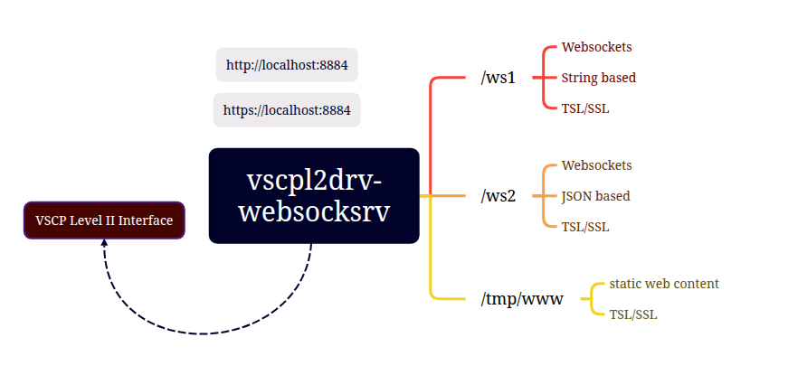

# vscpl2drv-websocksrv

  * **Available for**: Linux (Including Raspberry Pi 32/64-bit), Windows, MacOS
  * **Driver Linux**: libvscpl2drv-websocksrv.so
  * **Driver Windows**: vscpl2drv-websocksrv.dll
  * **Driver MacOS**: libvscpl2drv-websocksrv.dylib

## Introduction

The websocket driver is a level II driver and act as a websocket server for the VSCP ws1 and ws2 websocket protocols. Users or IoT/m2m devices with different privileges and rights can connect to the exported interface and send/receive VSCP events. Typically this is a web based HMI or IoT/m2m device that uses the VSCP protocol to communicate. This makes it very easy to display data from the VSCP network in a web browser widget or graphical control panel.

It is also possible to serve static web content with the driver. This can be used to serve a simple web based HMI.

* Documentation is available [here](https://grodansparadis.github.io/vscpl2drv-websocksrv)
* Repository for the module is [here](https://github.com/grodansparadis/vscpl2drv-websocksrv)

### Documentation deployment

In **Settings → Pages → Build and deployment**, set **Source** to **GitHub Actions**
to use the repository's Pages workflow instead of the generated branch deployment.
The workflow publishes `docs/` unchanged on documentation updates to `main` and
can also be run manually. It serializes deployments and allows 20 minutes for
Pages queueing and updates, rather than the default 10-minute deployment timeout.

The VSCP ws1 and ws2 websocket protocols are described [here](https://grodansparadis.github.io/vscp-doc-spec/#/./vscp_websocket).

The level II driver API is [described here](https://grodansparadis.github.io/vscp-doc-spec/#/./vscp_driver_interfaces). With the simple interface API the VSCP level II driver uses (described above) it is also easy to use it with other software as a component.

The connection can be secured with TLS/SSL as well as a simple user authentication mechanism.

## Other sources of information

 * The VSCP site - https://www.vscp.org
 * The VSCP document site - https://docs.vscp.org/
 * VSCP discussions - https://github.com/grodansparadis/vscp/discussions
 * https://www.baeldung.com/linux/shell-read-websocket-response
 * Test with `wscat -c ws://localhost:8884/ws1` or `wscat -c ws://localhost:8884/ws2`
 * AES on-line encryption/decryption - https://emn178.github.io/online-tools/aes/encrypt/