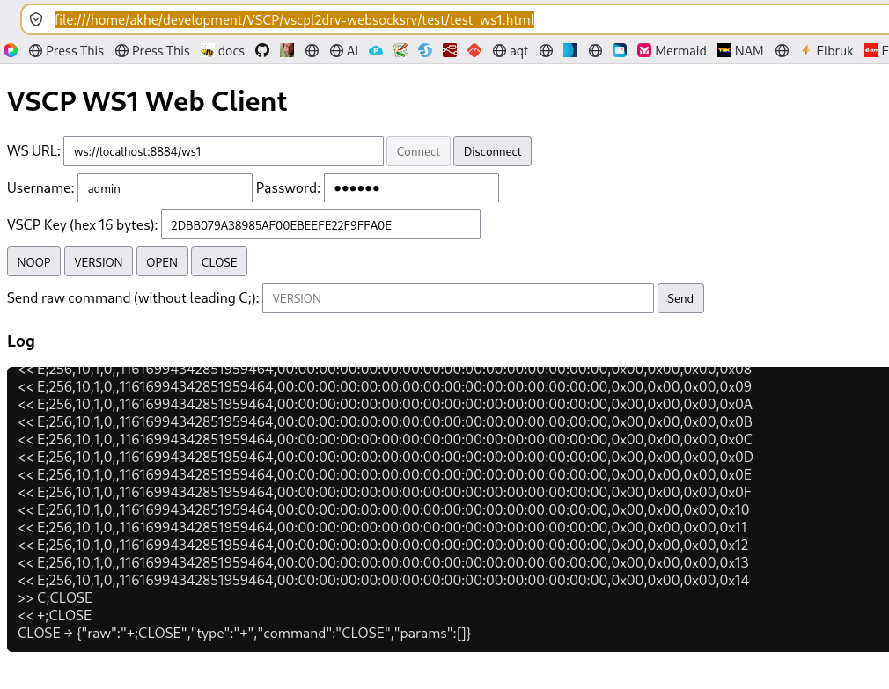
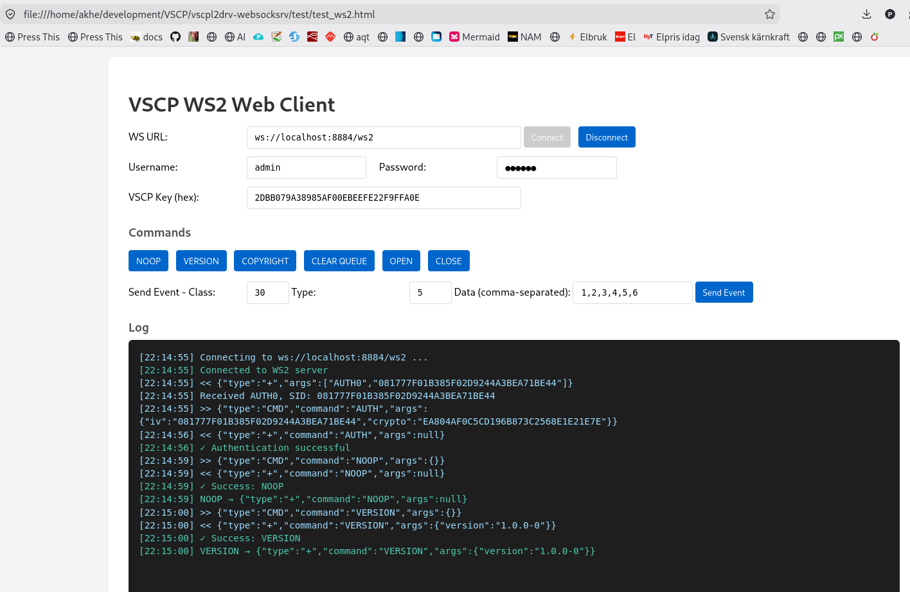

A typical use of vscpl2drv-websocksrv is when you want to visualize data from a VSCP node. By using the websocket interface you can publish live data on a web page with ease and the lowest possible resource overhead. The data can come from nodes connected to the network in different ways. One common way to retrieve data is through the event flow on a MQTT server as the VSCP MQTT daemon can publish data this way. Events on the MQTT subscribed topics will be received over the open websocket channel and is ready for display. Events sent using the websocket interface will be published on the configured publish topics and the functionality can be used for command button interactions etc.

Connected nodes may use a websocket interface to interface the world. In this case the driver can be used as the middleware between the VSCP network and the websocket connected nodes. A host can use the websocket driver to connect to such a node in a secure way.

## Connecting to the WebSocket server

The `interface` setting selects the listener address and whether transport
encryption is used. The WS1 or WS2 protocol is selected by the URL path,
configured by `url-ws1` and `url-ws2`; the server does not require a WebSocket
subprotocol header.

For a local listener without TLS, configure:

```json
{
  "interface": "ws://127.0.0.1:8884",
  "enable-ws1": true,
  "enable-ws2": true,
  "url-ws1": "/ws1",
  "url-ws2": "/ws2"
}
```

Connect to WS1 at `ws://127.0.0.1:8884/ws1` or WS2 at
`ws://127.0.0.1:8884/ws2`.

For a TLS-enabled listener, configure the interface with `wss://` and set the
server certificate and private-key paths:

```json
{
  "interface": "wss://vscp.example.org:8884",
  "enable-ws1": true,
  "enable-ws2": true,
  "url-ws1": "/ws1",
  "url-ws2": "/ws2",
  "tls": {
    "cert": "/etc/vscp/certs/cert.pem",
    "key": "/etc/vscp/certs/key.pem"
  }
}
```

Clients then connect to `wss://vscp.example.org:8884/ws1` or
`wss://vscp.example.org:8884/ws2`. Use a certificate trusted by the client and
whose name matches the hostname in the URL. For a self-signed certificate,
install and trust the issuing certificate on the client; do not disable
certificate verification. When a web page is loaded over HTTPS, browsers
require its WebSocket connection to use `wss://`.

In a browser, the transport connection is created with the standard
`WebSocket` API. Choose the route for the protocol and use either URL scheme:

```javascript
// Choose one URL:
const url = "ws://127.0.0.1:8884/ws1";       // WS1 without TLS
// const url = "ws://127.0.0.1:8884/ws2";    // WS2 without TLS
// const url = "wss://vscp.example.org:8884/ws1"; // WS1 with TLS
// const url = "wss://vscp.example.org:8884/ws2"; // WS2 with TLS

const ws = new WebSocket(url);
ws.addEventListener("open", () => console.log("WebSocket connected"));
ws.addEventListener("message", (event) => console.log("Server:", event.data));
ws.addEventListener("error", (event) => console.error("WebSocket error:", event));
ws.addEventListener("close", (event) => console.log("WebSocket closed:", event.code));
```

The server immediately starts the VSCP authentication handshake after the
WebSocket upgrade. A client must answer the `AUTH0` challenge using the
configured VSCP encryption key and its user credentials before it can issue
commands or exchange events. Authentication is part of the VSCP protocol; the
WebSocket `open` event only confirms that the transport connected. The sample
clients below implement the WS1 and WS2 challenge/response formats. Use the
matching client as a starting point when adding authentication to an
application. For TLS, change the sample URL from `ws://` to `wss://` and point
it at the TLS listener.

The initial challenge and authentication command differ by protocol:

| Protocol | Server challenge | Client authentication command |
| -------- | ---------------- | ------------------------------ |
| WS1 | `+;AUTH0;<sid>` | `C;AUTH;<sid>;<ciphertext-hex>` |
| WS2 | `{"type":"+","command":"AUTH","args":["AUTH0","<sid>"]}` | `{"type":"CMD","command":"AUTH","args":{"iv":"<sid>","crypto":"<ciphertext-hex>"}}` |

Here `<sid>` is the server-provided 16-byte session ID encoded as hex. The
ciphertext is the zero-padded AES-128-CBC encryption of `username:password`,
using the session ID as the IV and the same key configured by the server's
`key-file`. On success, WS1 replies with `+;AUTH1;...` and WS2 replies with a
positive `AUTH` response. Do not send a plaintext password as a WebSocket
message. Prefer `wss://` outside a trusted local test environment: the VSCP
authentication cipher is not a substitute for transport security.

## Testing ws1 in a web browser


There is a sample web client for testing the ws1 protocol in a web browser. The client is available [here](https://github.com/grodansparadis/vscpl2drv-websocksrv/blob/main/test/test_ws1.html).

A demo server is also available for testing [here](wss://vscp1.vscp.org:8884). Note that this is a public server and that data sent here may be visible to others. Username and password for the demo server is _admin/secret_ and default key.

### C, Python, node.js sample clients

The [sample-client guide](../test/README.md#sample-clients) explains how to
install dependencies and run the C, Python, and Node.js WS1 clients.

## Testing ws2 in a web browser


There is a sample web client for testing the ws2 protocol in a web browser. The client is available [here](https://github.com/grodansparadis/vscpl2drv-websocksrv/blob/main/test/test_ws2.html).

A demo server is also available for testing [here](wss://vscp1.vscp.org:8884). Note that this is a public server and that data sent here may be visible to others. Username and password for the demo server is _admin/secret_ and default key.

### C, Python, node.js sample clients 

The [sample-client guide](../test/README.md#sample-clients) explains how to
install dependencies and run the C, Python, and Node.js WS2 clients.

## Running the Python, JavaScript, and C clients

Start [testapp](#running-the-test-app-as-a-ws1ws2-server) in a separate terminal.
It hosts both protocols without requiring a VSCP daemon or MQTT broker. Run the
following commands from the repository root.

All six clients log in, send commands, open the event channel, send a sample
class 30/type 5 event, and display events received from the server.

### Python

Install Python 3.9 or later and create a virtual environment:

```bash
python3 -m venv .venv
source .venv/bin/activate
python -m pip install websocket-client pycryptodome
python test/test_ws1.py
python test/test_ws2.py
```

On Windows PowerShell, activate with `.venv\Scripts\Activate.ps1`. The required
packages are `websocket-client` and `pycryptodome`, not `websockets` and
`cryptography`. Each client listens briefly, sends **CLOSE**, and exits.

### JavaScript (Node.js)

Install Node.js and the `ws` package. AES support uses Node's built-in crypto
module:

```bash
npm install --prefix test --no-save ws
node test/test_ws1.js
node test/test_ws2.js
```

The clients wait for authentication to succeed before issuing commands. They
send a sample event, listen briefly, and then close the connection.

### C

Install a C compiler, CMake, and OpenSSL development libraries, then build the
clients independently of the driver:

```bash
cmake -S test -B build/clients
cmake --build build/clients --parallel
./build/clients/test_ws1
./build/clients/test_ws2
```

Each C client stays connected until **Ctrl-C**. For an automated seven-second
run that checks authentication and bidirectional events:

```bash
VSCP_TEST_SECONDS=7 ./build/clients/test_ws1
VSCP_TEST_SECONDS=7 ./build/clients/test_ws2
```

With Visual Studio, configure using the vcpkg toolchain described in
[Building on Windows](./build.md#build-from-source-on-windows), build with
`--config Release`, and run the executables from `build/clients/Release`.
The C samples support `ws://` only; use Python or JavaScript for `wss://`.

### Connection settings and TLS

The clients default to the sample account `admin` / `secret` and the sample
AES key. Override these settings through environment variables:

| Variable | Purpose |
| -------- | ------- |
| `VSCP_WS_URL` | Full endpoint URL, including `/ws1` or `/ws2`. Defaults to `ws://localhost:8884/ws1` or `/ws2`, matching the client. |
| `VSCP_USERNAME` | Login name; defaults to `admin`. |
| `VSCP_PASSWORD` | Account password; defaults to `secret`. |
| `VSCP_KEY_HEX` | Shared 16-byte AES authentication key as 32 hex characters; defaults to `2DBB079A38985AF00EBEEFE22F9FFA0E`. |
| `VSCP_TEST_SECONDS` | C clients only: run for this many seconds, then close; `0` or unset means run until Ctrl-C. |

For example:

```bash
VSCP_WS_URL=ws://127.0.0.1:8884/ws1 python test/test_ws1.py
VSCP_WS_URL=wss://vscp.example.org:8884/ws2 node test/test_ws2.js
```

In PowerShell:

```powershell
$env:VSCP_WS_URL = "ws://127.0.0.1:8884/ws2"
node test/test_ws2.js
```

Use the client matching the URL's protocol. For a custom server `key-file`,
set `VSCP_KEY_HEX` to its first 32 hex characters. Python and JavaScript verify
TLS certificates; trust the issuing CA rather than disabling verification.
Node.js supports an additional CA file through `NODE_EXTRA_CA_CERTS`.

Clients exit with a nonzero status on failure. Check their output and the
server log for authentication or command errors. The
[sample-client guide](../test/README.md#cross-language-regression-test) also
documents an automated test that runs all six clients against an isolated
server.

These are development clients. Their password strings and environment
variables are **not secure-memory storage**, even though the server protects
its own credential buffers. Do not put production passwords in source files or
shell history. See [Password memory protection](./security.md#password-memory-protection)
for the guarantees and limitations.

## Make your own application that interface the websocket level II driver

Easiest is of course to link to the driver shared library from your own application. You can also load the driver manually at runtime if you want to be able to load different drivers without recompiling your application. The interface description is available [here](https://github.com/grodansparadis/vscp/blob/master/src/vscp/common/level2drvdef.h) and [here](https://grodansparadis.github.io/vscp-mqtt-daemon/#/level_ii_drivers)

## Running the test app as a WS1/WS2 server

The test app (**testapp**) runs the WebSocket driver without a VSCP daemon or MQTT broker.
It loads the Level II driver library, starts the listener using a configuration
file, generates demonstration events, and prints events received from clients.
It is a local development tool, not a production server.

### 1. Build the driver and test app

Install the dependencies described in [Build from source](./build.md), then run
these commands from the repository root:

```bash
cmake -S . -B build -DCMAKE_BUILD_TYPE=Release
cmake --build build --target vscpl2drv-websocksrv testapp --parallel
```

Build both targets: the test app loads the driver at runtime, so building only
`testapp` does not build the driver library.

### 2. Choose a configuration

On Linux, use the supplied [test configuration](../debug/linux/websocksrv.json).
It enables both protocols with the following settings:

```json
{
  "enable-ws1": true,
  "enable-ws2": true,
  "url-ws1": "/ws1",
  "url-ws2": "/ws2",
  "interface": "ws://localhost:8884",
  "path-users": "debug/users.json"
}
```

Run the app from the repository root. Relative paths, including `path-users`,
are resolved from the process's working directory, not the configuration file's
directory. The sample configuration writes its log to
`/tmp/vscpl2drv-websocksrv.log`.

For a custom configuration, copy the sample and adjust the listener, user-file,
and logging paths. On Windows, replace the `/tmp` log path with a writable
Windows path. See [Configuration](./configure.md) for the available settings.

### 3. Start the testapp server

On Linux:

```bash
./build/testapp/bin/testapp \
  --driver ./build/libvscpl2drv-websocksrv.so \
  --config ./debug/linux/websocksrv.json
```

On macOS, use the same command with
`--driver ./build/libvscpl2drv-websocksrv.dylib`.

For a Windows Visual Studio Release build, use PowerShell and your adjusted
configuration file:

```powershell
cmake --build build --config Release --target vscpl2drv-websocksrv testapp
.\build\testapp\bin\Release\testapp.exe `
  --driver .\build\Release\vscpl2drv-websocksrv.dll `
  --config C:\vscp\websocksrv.json
```

Configure the Windows build first using the toolchain instructions in
[Build from source on Windows](./build.md#build-from-source-on-windows).
For a Debug build, replace `Release` with `Debug` in the command and paths.

The command-line options are:

| Option | Description |
| ------ | ----------- |
| `--driver <path>` | Required. Path to the built driver shared library (`.so`, `.dylib`, or `.dll`). |
| `--config <path>` | Required. Path to the server's JSON configuration file. |
| `--guid <guid>` | Optional. Driver GUID in colon-separated, 16-byte format. Defaults to `FF:FF:FF:FF:FF:FF:FF:FE:00:00:00:00:00:00:00:01`. |
| `--help`, `-h` | Print usage and exit. |

The server listens on `ws://localhost:8884/ws1` for WS1 and
`ws://localhost:8884/ws2` for WS2. The URL path selects the protocol. The test
configuration enables both. Keep the terminal open while testing.





### 4. Connect a browser client

1. Open [the WS1 client](../test/test_ws1.html) or
   [the WS2 client](../test/test_ws2.html) from your checkout in a browser.
2. Set **WS URL** to `ws://localhost:8884/ws1` for WS1 or
   `ws://localhost:8884/ws2` for WS2.
3. Use username `admin` and password `secret`. Leave the client's prefilled
   VSCP key unchanged for the sample configuration. If you configure a custom
   `key-file`, enter the matching key in the client.
4. Click **Connect** and wait for authentication to succeed in the client log.
   A connected WebSocket alone does not mean authentication has succeeded.
5. Click **VERSION** to check that commands work, then **OPEN** to enable event
   reception.
6. Watch the client log for demonstration measurement-count events. The app
   sends an event after a receive timeout of about one second; continuous
   incoming traffic can delay these demonstration events.
7. In the WS2 client, use **Send Event** to send an event back to the app.
   The app's terminal prints a `Received event:` line with the event's class,
   type, timestamp, and data size.

The sample [user file](../debug/users.json) also contains `user`, `special1`,
and `vscp`, all with the demo password `secret`. Permissions differ between
accounts; use `admin` for the walkthrough above.

These credentials and the default encryption key are for local testing only.
The sample server binds to localhost. Do not expose it to a network or reuse
these accounts in a deployed server. For TLS testing, configure certificates
and use the `wss://` URLs described in
[Connecting to the WebSocket server](#connecting-to-the-websocket-server).

### 5. Stop the server

Click **Disconnect** in the browser and press **Ctrl-C** in the app's terminal.
The app closes the driver and prints `VSCP test server stopped.`

### Troubleshooting

- **Usage is printed immediately:** supply both `--driver` and `--config`.
  Each option must be followed by a value.
- **Unable to load driver library:** check the library path, build configuration,
  architecture, and availability of its runtime dependencies. On Windows,
  ensure dependency DLLs are available through `PATH` or beside the executable.
- **Unable to open the driver:** check the configuration path, JSON syntax,
  user-file path, and driver log. Run from the repository root when using the
  sample configuration.
- **Connection refused:** check the listener address and port, look for bind
  errors in the driver log, and make sure another server is not using port
  `8884`. The sample configuration disables static-file serving; open the
  browser clients separately rather than requesting them from the WebSocket
  listener.
- **Authentication fails:** check the username, password, and VSCP encryption
  key, and confirm that the user's host ACL allows the client address. Without
  `key-file`, the sample key is `2DBB079A38985AF00EBEEFE22F9FFA0E`.
  A `Malformed authentication data` message in the server log can indicate a
  mismatched key, even when the credentials are correct. After rebuilding the
  driver, stop and restart the test app so it loads the new library.
- **Connected but no events:** wait for authentication, click **OPEN**, and
  check the user's receive permissions and filters.

## Setting up your own VSCP Daemon for testing on Linux

If you have not already installed a VSCP daemon, choose one of these options:

- [vscp-tcpip-daemon](https://github.com/grodansparadis/vscp-tcpip-daemon), which provides a TCP/IP interface.
- [vscp-mqtt-daemon](https://github.com/grodansparadis/vscp-mqtt-daemon), which connects to an MQTT broker.

For general VSCP documentation, see [docs.vscp.org](https://docs.vscp.org/).

Add the following to the level II section of the VSCP daemon configuration file

### Configuration for the websocket level II driver

#### On the VSCP TCP/IP Daemon

``` json
{
  "enable" : true,
  "name" : "websocket-srv",
  "path-driver" : "/var/lib/vscp/drivers/level2/libvscpl2drv-websocksrv.so",
  "path-config" : "/etc/vscp/websocksrv.json",
  "guid" : "FF:FF:FF:FF:FF:FF:FF:F5:02:88:88:00:00:00:00:00",
}
```

Path given here should match the actual locations of the driver library and configuration file on your system. Adjust the paths if necessary.

Restart the vscp daemon

```bash
sudo systemctl restart vscpd
```

#### On the VSCP MQTT Daemon

``` json
{
  "enable" : true,
  "name" : "websocket-srv",
  "path-driver" : "/var/lib/vscp/drivers/level2/libvscpl2drv-websocksrv.so",
  "path-config" : "/etc/vscp/websocksrv.json",
  "guid" : "FF:FF:FF:FF:FF:FF:FF:F5:02:88:88:00:00:00:00:01",

  "mqtt": {
    "bind": "",
    "host": "test.mosquitto.org",
    "port": 1883,
    "mqtt-options": {
      "tcp-nodelay": true,
      "protocol-version": 311,
      "receive-maximum": 20,
      "send-maximum": 20,
      "ssl-ctx-with-defaults": 0,
      "tls-ocsp-required": 0,
      "tls-use-os-certs": 0
    },
    "user": "vscp",
    "password": "secret",
    "clientid": "the-vscp-daemon websocksrv driver",
    "publish-format": "json",
    "subscribe-format": "auto",
    "qos": 1,
    "bcleansession": false,
    "bretain": false,
    "keepalive": 60,
    "bjsonmeasurementblock": true,
    "reconnect": {
      "delay": 2,
      "delay-max": 10,
      "exponential-backoff": false
    },
    "tls": {
      "cafile": "",
      "capath": "",
      "certfile": "",
      "keyfile": "",
      "pwkeyfile": "",
      "no-hostname-checking": true,
      "cert-reqs": 0,
      "version": "",
      "ciphers": "",
      "psk": "",
      "psk-identity": ""
    },
    "will": {
      "topic": "vscp-daemon/{{srvguid}}/will",
      "qos": 1,
      "retain": true,
      "payload": "VSCP Daemon is down"
    },
    "subscribe" : [
      {
        "topic": "vscp/websocksrv/{{guid}}/#",
        "qos": 0,
        "v5-options": 0,
        "format": "auto"
      }
    ],
    "publish" : [
      {
        "topic": "vscp/{{guid}}/{{class}}/{{type}}/{{nodeid}}",
        "qos": 1,
        "retain": false,
        "format": "json"
      }
    ]
  }
}
```

Path given here should match the actual locations of the driver library and configuration file on your system. Adjust the paths if necessary.

```bash
sudo cp /var/share/vscpl2drv-websocksrv/websocksrv.json /etc/vscp
sudo cp /var/share/vscpl2drv-websocksrv/users.json /etc/vscp
```

Restart the vscp daemon

```bash
sudo systemctl restart mqttvscpd
```

[filename](./bottom-copyright.md ':include')