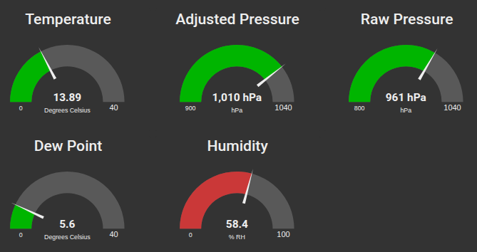
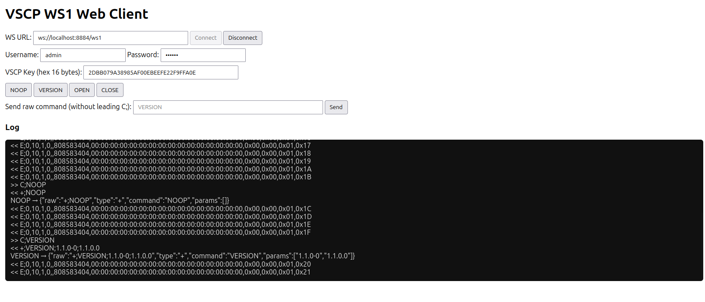
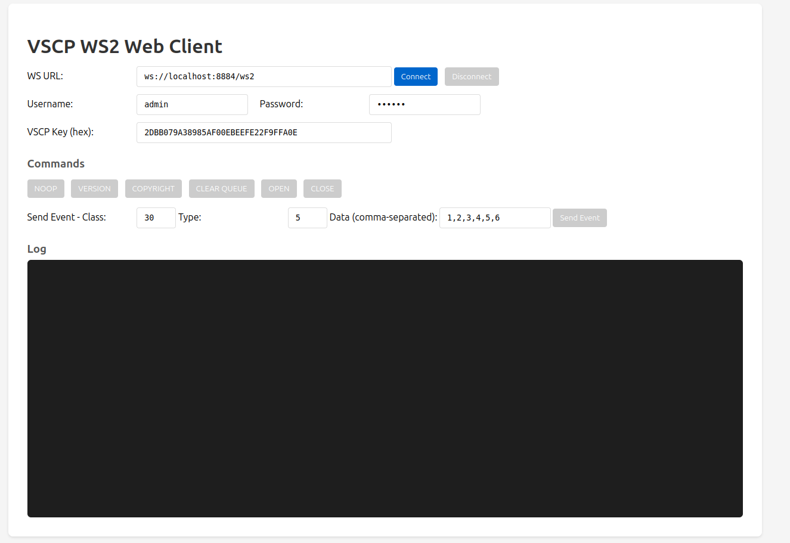

A typical use of vscpl2drv-websocksrv is when you want to visualize data from a VSCP node. By using the websocket interface you can publish live data on a web page with ease and the lowest possible resource overhead. The data can come from nodes connected to the network in different ways. One common way to retrieve data is through the event flow on a MQTT server as the VSCP daemon can publish data this way. Events on the MQTT subscribed topics will be received over the open websocket channel and is ready for display. Events sent using the websocket interface will be published on the configured publish topics and the functionality can be used for command button interactions etc.

Connected nodes may use a websocket interface to interface the world. In this case the driver can be used as the middleware between the VSCP network and the websocket connected nodes. A host can use the websocket driver to connect to such a node in a secure way.

## Connecting to the WebSocket server

The `interface` setting selects the listener address and whether transport
encryption is used. The WS1 or WS2 protocol is selected by the URL path,
configured by `url-ws1` and `url-ws2`; the server does not require a WebSocket
subprotocol header.

For a local listener without TLS, configure:

```json
{
  "interface": "ws://127.0.0.1:8884",
  "enable-ws1": true,
  "enable-ws2": true,
  "url-ws1": "/ws1",
  "url-ws2": "/ws2"
}
```

Connect to WS1 at `ws://127.0.0.1:8884/ws1` or WS2 at
`ws://127.0.0.1:8884/ws2`.

For a TLS-enabled listener, configure the interface with `wss://` and set the
server certificate and private-key paths:

```json
{
  "interface": "wss://vscp.example.org:8884",
  "enable-ws1": true,
  "enable-ws2": true,
  "url-ws1": "/ws1",
  "url-ws2": "/ws2",
  "tls": {
    "cert": "/etc/vscp/certs/cert.pem",
    "key": "/etc/vscp/certs/key.pem"
  }
}
```

Clients then connect to `wss://vscp.example.org:8884/ws1` or
`wss://vscp.example.org:8884/ws2`. Use a certificate trusted by the client and
whose name matches the hostname in the URL. For a self-signed certificate,
install and trust the issuing certificate on the client; do not disable
certificate verification. When a web page is loaded over HTTPS, browsers
require its WebSocket connection to use `wss://`.

In a browser, the transport connection is created with the standard
`WebSocket` API. Choose the route for the protocol and use either URL scheme:

```javascript
// Choose one URL:
const url = "ws://127.0.0.1:8884/ws1";       // WS1 without TLS
// const url = "ws://127.0.0.1:8884/ws2";    // WS2 without TLS
// const url = "wss://vscp.example.org:8884/ws1"; // WS1 with TLS
// const url = "wss://vscp.example.org:8884/ws2"; // WS2 with TLS

const ws = new WebSocket(url);
ws.addEventListener("open", () => console.log("WebSocket connected"));
ws.addEventListener("message", (event) => console.log("Server:", event.data));
ws.addEventListener("error", (event) => console.error("WebSocket error:", event));
ws.addEventListener("close", (event) => console.log("WebSocket closed:", event.code));
```

The server immediately starts the VSCP authentication handshake after the
WebSocket upgrade. A client must answer the `AUTH0` challenge using the
configured VSCP encryption key and its user credentials before it can issue
commands or exchange events. Authentication is part of the VSCP protocol; the
WebSocket `open` event only confirms that the transport connected. The sample
clients below implement the WS1 and WS2 challenge/response formats. Use the
matching client as a starting point when adding authentication to an
application. For TLS, change the sample URL from `ws://` to `wss://` and point
it at the TLS listener.

The initial challenge and authentication command differ by protocol:

| Protocol | Server challenge | Client authentication command |
| -------- | ---------------- | ------------------------------ |
| WS1 | `+;AUTH0;<sid>` | `C;AUTH;<sid>;<ciphertext-hex>` |
| WS2 | `{"type":"+","command":"AUTH","args":["AUTH0","<sid>"]}` | `{"type":"CMD","command":"AUTH","args":{"iv":"<sid>","crypto":"<ciphertext-hex>"}}` |

Here `<sid>` is the server-provided 16-byte session ID encoded as hex. The
ciphertext is the zero-padded AES-128-CBC encryption of `username:password`,
using the session ID as the IV and the same key configured by the server's
`key-file`. On success, WS1 replies with `+;AUTH1;...` and WS2 replies with a
positive `AUTH` response. Do not send a plaintext password as a WebSocket
message. Prefer `wss://` outside a trusted local test environment: the VSCP
authentication cipher is not a substitute for transport security.

## Testing ws1 in a web browser



There is a sample web client for testing the ws1 protocol in a web browser. The client is available [here](https://github.com/grodansparadis/vscpl2drv-websocksrv/blob/main/test/test_ws1.html).

A demo server is also available for testing [here](wss://vscp1.vscp.org:8884). Note that this is a public server and that data sent here may be visible to others. Username and password for the demo server is _admin/secret_ and default key.

### C, Python, node.js sample clients

In the same folder you can also find C, Python and node.js sample clients for testing the ws1 protocol.

## Testing ws2 in a web browser



There is a sample web client for testing the ws2 protocol in a web browser. The client is available [here](https://github.com/grodansparadis/vscpl2drv-websocksrv/blob/main/test/test_ws2.html).

A demo server is also available for testing [here](wss://vscp1.vscp.org:8884). Note that this is a public server and that data sent here may be visible to others. Username and password for the demo server is _admin/secret_ and default key.

### C, Python, node.js sample clients 

In the same folder you can also find C, Python and node.js sample clients for testing the ws2 protocol.

## Make your own application that interface the level II driver

It is very easy to interface VSCP Level II drivers from other software. Full information about the interface is [here](https://grodansparadis.github.io/vscp/#/level_ii_drivers)

Easiest is of course to link to the driver shared library from your own application. You can also load the driver manually at runtime if you want to be able to load different drivers without recompiling your application. The interface header is available [here](https://github.com/grodansparadis/vscp/blob/master/src/vscp/common/level2drvdef.h)

## Running the test app as a WS1/WS2 server

The test app opens the level II driver, which starts its websocket listener from
the supplied configuration file. Enable both protocols in that file:

```json
{
  "enable-ws1": true,
  "enable-ws2": true,
  "url-ws1": "/ws1",
  "url-ws2": "/ws2",
  "interface": "ws://localhost:8884",
  "path-users": "debug/users.json"
}
```

From the repository root, build and start the app (adjust the driver library
filename for your platform):

```bash
cmake --build build --target vscpl2drv-websocksrv testapp
./build/testapp/bin/testapp \
  --driver ./build/libvscpl2drv-websocksrv.so \
  --config ./debug/linux/websocksrv.json
```

The server listens on `ws://localhost:8884/ws1` for WS1 and
`ws://localhost:8884/ws2` for WS2. The URL path selects the protocol. The test
configuration enables both.
The app emits a VSCP measurement-count event once per second and prints events
it receives from connected clients. Stop it with Ctrl-C.

The sample `debug/users.json` contains the demo accounts `admin`, `user`,
`special1`, and `vscp`; their demo password is `secret`. These credentials are
for local testing only. The sample server binds to localhost. Do not expose it
to a network or reuse these accounts in a deployed server. For browser testing,
use the WS1 and WS2 sample clients linked above, configure the corresponding
endpoint path, and authenticate with a sample account.

The test app loads the driver library dynamically and accepts explicit library
and configuration paths, so it can also be used as a small example of the
Level II driver API:

```text
testapp --driver <driver-library> --config <server-config> [--guid <guid>]
```

## Setting up your own VSCP Daemon for testing on Linux

Download and install the VSCP Daemon if you don't have it already. See [here](https://grodansparadis.github.io/vscp/#/) for information on how to do this.

Add the following to the level II section of the VSCP daemon configuration file

``` json
{
  "enable" : true,
  "name" : "websocket-srv",
  "path-driver" : "/var/lib/vscp/drivers/level2/libvscpl2drv-websocksrv.so",
  "path-config" : "/etc/vscp/websocksrv.json",
  "guid" : "FF:FF:FF:FF:FF:FF:FF:F5:02:88:88:00:00:00:00:01",

  "mqtt": {
    "bind": "",
    "host": "test.mosquitto.org",
    "port": 1883,
    "mqtt-options": {
      "tcp-nodelay": true,
      "protocol-version": 311,
      "receive-maximum": 20,
      "send-maximum": 20,
      "ssl-ctx-with-defaults": 0,
      "tls-ocsp-required": 0,
      "tls-use-os-certs": 0
    },
    "user": "vscp",
    "password": "secret",
    "clientid": "the-vscp-daemon websocksrv driver",
    "publish-format": "json",
    "subscribe-format": "auto",
    "qos": 1,
    "bcleansession": false,
    "bretain": false,
    "keepalive": 60,
    "bjsonmeasurementblock": true,
    "reconnect": {
      "delay": 2,
      "delay-max": 10,
      "exponential-backoff": false
    },
    "tls": {
      "cafile": "",
      "capath": "",
      "certfile": "",
      "keyfile": "",
      "pwkeyfile": "",
      "no-hostname-checking": true,
      "cert-reqs": 0,
      "version": "",
      "ciphers": "",
      "psk": "",
      "psk-identity": ""
    },
    "will": {
      "topic": "vscp-daemon/{{srvguid}}/will",
      "qos": 1,
      "retain": true,
      "payload": "VSCP Daemon is down"
    },
    "subscribe" : [
      {
        "topic": "vscp/websocksrv/{{guid}}/#",
        "qos": 0,
        "v5-options": 0,
        "format": "auto"
      }
    ],
    "publish" : [
      {
        "topic": "vscp/{{guid}}/{{class}}/{{type}}/{{nodeid}}",
        "qos": 1,
        "retain": false,
        "format": "json"
      }
    ]
  }
}
```

Copy _/var/share/vscpl2drv-websocksrv/websocksrv.json_ and _/var/share/vscpl2drv-websocksrv/users.json_ to _/etc/vscp_

```bash
sudo cp /var/share/vscpl2drv-websocksrv/websocksrv.json /etc/vscp
sudo cp /var/share/vscpl2drv-websocksrv/users.json /etc/vscp
```

Restart the vscp daemon

```bash
sudo systemctl restart vscpd
```


[filename](./bottom-copyright.md ':include')